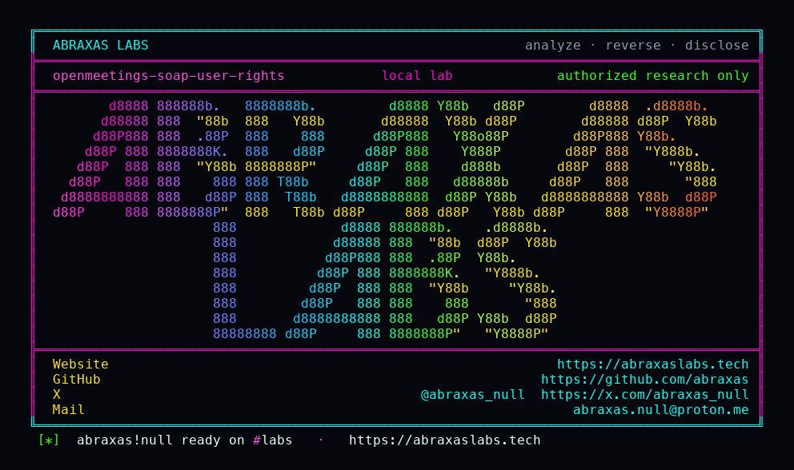

<p align="center">
  
</p>

<p align="center">
  <a href="https://abraxaslabs.tech"><strong>abraxaslabs.tech</strong></a>
  &nbsp;·&nbsp;
  <a href="https://github.com/abraxas">github.com/abraxas</a>
  &nbsp;·&nbsp;
  <a href="https://x.com/abraxas_null">@abraxas_null</a>
  &nbsp;·&nbsp;
  <a href="mailto:abraxas.null@proton.me">abraxas.null@proton.me</a>
  &nbsp;·&nbsp;
  <a href="https://github.com/abraxas/openmeetings-soap-user-rights">openmeetings-soap-user-rights</a>
</p>
<p align="center">
  Write-up: <a href="https://abraxaslabs.tech/research/openmeetings-9-1-0-leftovers"><strong>https://abraxaslabs.tech/research/openmeetings-9-1-0-leftovers</strong></a>
</p>


# openmeetings-soap-user-rights

**Class:** Privilege leftover
**Reach:** Remote

**Apache OpenMeetings** `9.1.0`. SOAP `POST /user/` copies `UserDTO.rights` and will update by `id`. SOAP is the LMS integration account. It is supposed to stay below ADMIN. `UserMapper` does `userDao.get(dto.getId())` then `u.setRights(dto.getRights())`. `UserWebService.add` adds ROOM/LOGIN/DASHBOARD and never strips ADMIN.

| | |
|---|---|
| ID | no CVE yet |
| Class | **Privilege leftover** |
| Reach | **Remote** (SOAP SID) |
| CWE | [CWE-269](https://cwe.mitre.org/data/definitions/269.html), [CWE-280](https://cwe.mitre.org/data/definitions/280.html) |
| CVSS | **High: 8.8** `CVSS:3.1/AV:N/AC:L/PR:L/UI:N/S:U/C:H/I:H/A:H` |
| Product | [Apache OpenMeetings](https://github.com/apache/openmeetings) 9.1.0 |
| Auth | `Right.SOAP` (not ADMIN) |
| License | [GNU Affero GPL v3.0](LICENSE) |
| Lab | `127.0.0.1:18152` only |

## What an attacker can do

| Method | Sink | Privilege |
|---|---|---|
| SOAP `POST /services/user/?sid=` `rights=["ADMIN"]` | `UserMapper.setRights` + `userDao.update` | **Integrity (lab-proven):** plant ADMIN. Lab: `plantedadm` firstname witness, `DELETE /user/3` as planted user returned 200 Deleted. SOAP-only `soaplab` DELETE was `error.notallowed`. |
| Same POST with existing `id` | `userDao.get(dto.getId())` | **Integrity (lab-proven):** id-merge overwrite. Lab: user 4 login `mergeover` with ADMIN. |

**Closed:** `DELETE /user/{id}` still needs ADMIN. ROOM SID is `NO_PERMISSION` on add. Frontend register does not take a rights array.

## Lab

```bash
cd lab
./run.sh
```

Last line: `SUCCESS OPENMEETINGS-SOAP-RIGHTS-WITNESS`

Suggested fix: ignore `UserDTO.rights` on SOAP add, or allow only LOGIN/ROOM/DASHBOARD. Never load-by-id on add. Strip ADMIN/SOAP unless the caller is ADMIN.

## Contact

Abraxas Labs - https://abraxaslabs.tech - https://github.com/abraxas - https://x.com/abraxas_null - abraxas.null@proton.me

Vendor: security@openmeetings.apache.org
